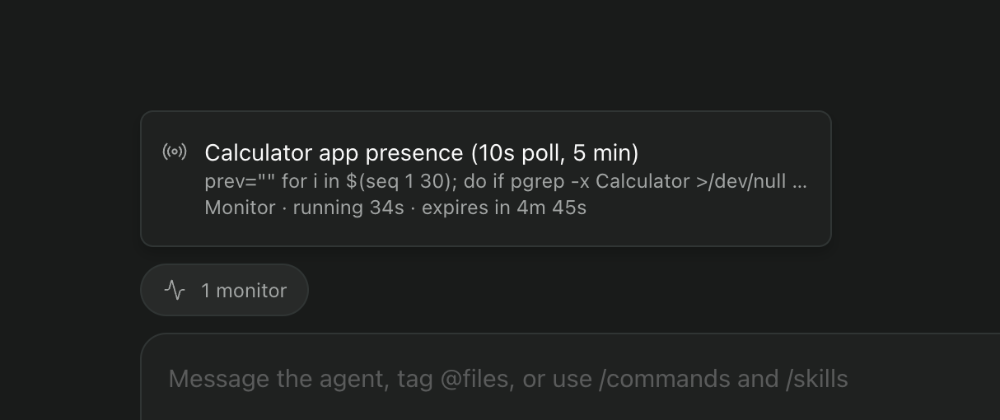

# Background work for Paseo

A [Paseo](https://paseo.sh) plugin that shows the work a Claude agent left running after its turn
ended: `Monitor` watches and `Bash` commands started with `run_in_background`.

When an agent has background work, a pill appears above its composer ("1 monitor", "2 shells", or
"3 running" for a mix). Press it to see each task's description, command, how long it has been
running, and when a Monitor expires. The pill disappears when the work ends.



Without it, an idle Claude session that is still watching CI or running a long test suite looks the
same as one that is finished.

## Install

Requires Paseo 0.15.1 or later, with plugins enabled.

```bash
paseo plugin add github:yoava333/paseo-background-work
```

Or paste `github:yoava333/paseo-background-work` into **Settings → Plugins** in the app.

Update to the latest commit with `paseo plugin update background-work`, and remove it with
`paseo plugin remove background-work`.

## How it works

Paseo does not pass Claude's background task list to plugins, so the plugin reads it from the
agent timeline on the daemon:

| Signal                                                           | Effect                    |
| ---------------------------------------------------------------- | ------------------------- |
| `Monitor` result starting `Monitor started (task <id>, …)`       | Monitor starts            |
| `Bash` result starting `Command running in background with ID:`  | Shell starts              |
| `task_notification` with `metadata.taskId` and a `status`        | Task ends                 |
| Monitor `timeout_ms` passed                                      | Monitor ends              |
| `thread_started`, or `turn_failed` "Claude stopped unexpectedly" | All the agent's tasks end |
| Agent `closed` or archived                                       | All the agent's tasks end |

`server/tracker.ts` starts with the first request from an app and follows every live agent's
timeline. It replays up to 2,000 timeline rows per agent on start. `client/background-work.tsx`
asks for the current list every 3 seconds and updates the pills. It polls because plugin
subscriptions are newer than the Paseo 0.15 releases.

## Limitations

- Only Claude Code agents. Other providers report background work differently or not at all.
- Detection matches Claude Code's result text. If Claude Code rewords it, tasks stop appearing until
  the patterns in `shared/background-work.ts` are updated.
- No live Monitor events, because Paseo does not receive them while the session runs.
- No Stop button. Plugins cannot stop a Claude background task.
- Pills can lag the real state by up to 3 seconds.

## Development

```bash
npm install
npm run typecheck
npm test
paseo plugin install "$PWD"        # install your checkout instead of the GitHub source
paseo plugin reload background-work
```

## License

MIT
